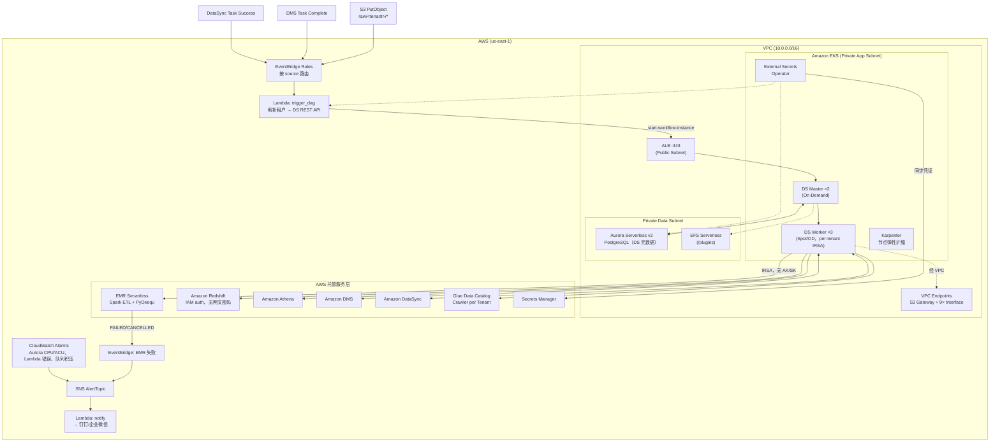
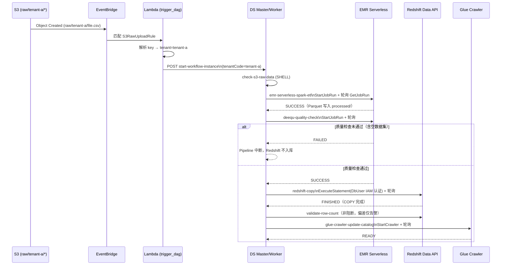

# 架构文档 — Apache DolphinScheduler on AWS

> 版本：1.0 | 日期：2026-06-29

---

## 1. 系统概述

本系统在 Amazon EKS 上部署 Apache DolphinScheduler，作为企业数据平台的统一任务调度引擎，支持 EMR Serverless、Redshift、DMS、DataSync、Athena 等 AWS 数据服务的可视化 DAG 编排，并通过 EventBridge 实现事件驱动触发。

### 核心设计原则

| 原则 | 实现方式 |
|------|---------|
| 无明文凭证 | IRSA + Secrets Manager + ESO，零 AK/SK 配置 |
| 事件驱动 | EventBridge → Lambda → DS REST API，告别纯 Cron |
| 多租户隔离 | 每租户独立 IAM Role / EMR App / Athena WorkGroup |
| GitOps DAG | DAG JSON 版本化，PR 合并后 GitHub Actions 自动同步 |
| 数据质量门禁 | PyDeequ on EMR Serverless，质检失败阻断入库 |

---

## 2. 相比[原版博客](https://aws.amazon.com/cn/blogs/china/data-task-scheduling-using-apache-dolphinscheduler-on-aws/)的优化点

### 2.1 触发模式：Cron → 事件驱动

原博客只支持定时触发。本方案通过 EventBridge → Lambda → DS REST API 链路，将 S3 文件到达、DMS 同步完成、DataSync 传输成功等事件直接转化为 DAG Run，上游数据就绪即触发，消除了"定时轮询间隔"的猜测和等待。

### 2.2 EMR on EC2 → EMR Serverless

原博客用 `RunJobFlow` 起 EMR 集群，Master 节点常驻计费，冷启动 5–10 分钟。本方案改用 EMR Serverless，无集群管理，按 vCPU/GB·秒计费，等效负载下成本约低 47%，Spot 中断无需自行处理。

### 2.3 明文凭证 → IRSA + Secrets Manager + ESO

原博客在 ConfigMap 或 Helm values 里直接写 `accessKey`、`secretKey`、数据库密码。本方案：

- AWS API 调用全走 IRSA，Pod 的 Web Identity Token 由 EKS 自动颁发和轮换，代码里没有任何 AK/SK
- 数据库密码由 CDK 自动生成并写入 Secrets Manager，External Secrets Operator 定期同步为 K8s Secret 挂载
- 代码仓库和 K8s 集群内找不到任何凭证明文

### 2.4 Web UI 手动画 DAG → GitOps

原博客通过 Web UI 拖拽创建工作流，无变更历史，多人协作容易相互覆盖。本方案 DAG 定义以 JSON 存储在 Git 仓库，PR 合并后 GitHub Actions 自动调用 DS REST API 导入，变更全程可追溯、可 Review、可一键回滚。

### 2.5 无质量门禁 → PyDeequ 数据质量检测

原博客 ETL 完成后直接写入 Redshift，没有任何数据校验。本方案在 ETL 和 Redshift COPY 之间插入 PyDeequ 节点（运行在 EMR Serverless），对非空性、正数约束、取值范围、重复记录等规则进行检测，任意规则失败则 `os._exit(1)` → DS 任务 FAILED → Pipeline 中断，脏数据不入库。

### 2.6 无租户隔离 → 全层多租户

原博客是单租户架构，所有工作流共用同一套凭证和计算资源。本方案每个租户有独立的：

| 层次 | 隔离资源 |
|------|---------|
| 权限层 | 独立 IRSA Role，S3 前缀 / EMR App / Athena WorkGroup 各自限定 |
| 计算层 | 独立 EMR Serverless Application，按 Tag 隔离计费 |
| 查询层 | 独立 Athena WorkGroup，限定输出路径和 10 GB 扫描上限 |
| 数据层 | 独立 Glue Database 和 Redshift DB User |

租户 A 的 Worker Pod 在 IAM Policy 层面拿不到租户 B 的任何数据。

### 2.7 Terraform → AWS CDK TypeScript

原博客用 Terraform 管理基础设施（或手动控制台操作）。本方案用 CDK TypeScript，4 个 Stack 通过类型安全的 props 传递跨 Stack 引用，`cluster.addServiceAccount()` / `cluster.addManifest()` 直接管理 K8s 资源，编译期即可发现配置错误，无需维护共享状态文件。

---

## 3. 整体架构图



Web/事件触发统一走 EventBridge → Lambda(`trigger_dag`) → DS REST API 这条路径，S3 文件到达、DMS 同步完成、DataSync 传输成功三类事件都在这里解析出租户后转成对应 DAG 的一次 `start-workflow-instance` 调用。DS Master 接到请求后把任务分发给 Worker 执行——Worker 的 SHELL/PYTHON 任务实际以共享的 `dolphinscheduler` ServiceAccount（落到 EKS 节点角色）身份调用 AWS API，并不是文档最初设想的按租户 IRSA 隔离（详见 §10 的落差说明）。EMR Serverless job 失败会触发另一条独立的 EventBridge 规则直接发 SNS 告警，不经过 DS，也不占用 DAG 重试预算。

<details>
<summary>更详细的网段与组件清单（点击展开）</summary>

```
┌─────────────── 外部触发层 ──────────────────────────────────────────┐
│  S3 PutObject (raw/*)  ──┐                                          │
│  DMS Task Complete      ──┼──▶ EventBridge Rule ──▶ Lambda ──────┐  │
│  DataSync Task Success  ──┘     (按 source 路由)    (解析租户)    │  │
│  定时 Cron ─────────────────────────────────────────────────────│  │
└────────────────────────────────────────────────────────────────┼──┘
                                                                 │ DS REST API
┌──────────────────── VPC (10.0.0.0/16) ─────────────────────────▼──┐
│                                                                     │
│  Public Subnets (10.0.1.0/24, 10.0.2.0/24)                        │
│  └─ ALB (HTTPS:443) ──────────────────────────────────────────┐    │
│                                                               │    │
│  Private App Subnets (10.0.10.0/24, 10.0.11.0/24)            │    │
│  └─ Amazon EKS                                                │    │
│      ├─ Master Pods (2 replicas, On-Demand)  ◀────────────────┘    │
│      ├─ Worker Pods (3 replicas, Spot/OD)                          │
│      │   └─ 每租户绑定独立 IRSA Role (OIDC)                         │
│      ├─ External Secrets Operator (ESO)                            │
│      └─ Karpenter (节点弹性扩缩)                                    │
│                                                                     │
│  Private Data Subnets (10.0.20.0/24, 10.0.21.0/24)                │
│  ├─ Aurora Serverless v2 PostgreSQL 15.4 (0.5–16 ACU)              │
│  ├─ Amazon EFS Serverless (/plugins AccessPoint)                    │
│  └─ Amazon Redshift (dc2.large, 私有子网)                           │
│                                                                     │
│  VPC Endpoints (私有路径，消除 NAT 费用)                             │
│  ├─ S3 Gateway Endpoint                                             │
│  └─ 9× Interface Endpoints:                                         │
│      EMR / Athena / SecretsManager / DMS / DataSync /              │
│      Redshift / ECR API / ECR DKR / STS / CloudWatchLogs           │
└─────────────────────────────────────────────────────────────────────┘

AWS 托管服务层
├─ EMR Serverless   (Spark ETL + PyDeequ 质检，按需，无冷启动费)
├─ Amazon Redshift  (分析型数仓，IAM auth，无明文密码)
├─ Amazon Athena    (按需 SQL 查询，WorkGroup 隔离)
├─ Amazon DMS       (异构数据库迁移)
├─ Amazon DataSync  (文件传输)
├─ Secrets Manager  (凭证集中管理)
├─ Glue Data Catalog (表结构自动更新，Crawler per Tenant)
├─ SNS + Lambda     (告警 → 钉钉/企业微信)
└─ CloudWatch Alarms (Aurora CPU/ACU / Lambda 错误 / 队列积压)
```

</details>

---

## 4. CDK Stack 结构

```
NetworkingStack (DsNetworkingStack)
│  VPC + 子网 + 安全组 + VPC Endpoints
│  输出: vpc, albSg, eksSg, auroraSg, efsSg, redshiftSg
↓
DataStack (DsDataStack)            EksStack (DsEksStack)
│  Aurora Serverless v2            │  EKS 1.30 + OIDC Provider
│  EFS Serverless + AccessPoint    │  System NodeGroup (On-Demand)
│  Redshift + CopyRole             │  Karpenter IRSA Role
│  输出: auroraCluster,            │  输出: cluster, oidcProviderArn,
│         redshiftEndpoint, ...    │         oidcIssuerUrl, nodeRole
↓                                  ↓
AppStack (DsAppStack)
   S3 BucketDeployment (scripts/)
   SNS AlertTopic + Notify Lambda (→ 钉钉/WeCom)
   EMR Serverless Job Role
   ESO IRSA Role
   Glue Shared Role
   Per-Tenant Loop [tenant-a, tenant-b, ...]:
     ├─ EMR Serverless Application
     ├─ Athena WorkGroup (限定输出路径 + 10GB 扫描上限)
     ├─ Glue Crawler (更新 Data Catalog)
     ├─ Tenant IRSA Role (最小权限)
     ├─ K8s ServiceAccount + IRSA annotation
     └─ K8s ConfigMap (EMR_APP_ID / REDSHIFT_HOST / ...)
   Trigger Lambda (EventBridge → DS REST API)
   EventBridge Rules: S3上传 / DMS完成 / DataSync完成 / EMR失败
   CloudWatch Alarms: AuroraCPU / AuroraACU / Lambda错误 / Worker队列
```

---

## 5. 网络与安全组

### 子网规划

| 子网类型 | CIDR | 承载资源 |
|---------|------|---------|
| Public | 10.0.1.0/24, 10.0.2.0/24 | ALB |
| Private App (egress) | 10.0.10.0/24, 10.0.11.0/24 | EKS Nodes, EFS |
| Private Isolated | 10.0.20.0/24, 10.0.21.0/24 | Aurora, Redshift |

### 安全组规则

| 安全组 | 入站 | 出站 | 用途 |
|--------|------|------|------|
| alb-sg | 0.0.0.0/0:443 | （默认全放行） | 公网 HTTPS 访问 |
| eks-sg | alb-sg:12345, eks-sg:all | （默认全放行） | ALB→DS UI / 节点间通信 |
| aurora-sg | eks-sg:5432 | 无出站规则（allowAllOutbound: false） | EKS→Aurora |
| efs-sg | eks-sg:2049 | 无出站规则（allowAllOutbound: false） | EKS→EFS 挂载 |
| redshift-sg | eks-sg:5439 | 0.0.0.0/0:443 | EKS→Redshift；出站规则是后补的 |
| endpoint-sg | eks-sg:443, redshift-sg:443 | 无出站规则（allowAllOutbound: false） | EKS/Redshift→VPC Interface Endpoints |

> **redshift-sg 出站规则踩坑记录**：这个集群默认开启了 Enhanced VPC Routing，意味着 COPY/UNLOAD 的 S3 访问和 IAM_ROLE 的 STS AssumeRole 调用都必须走 VPC（S3 Gateway Endpoint + STS Interface Endpoint），而不是 Redshift 平时走的公网路径。redshift-sg 最初只有一条入站规则（`allowAllOutbound: false` 且没有任何出站规则），导致 COPY 语句拿不到任何出站网络——现象不是报错，而是语句无限期卡在 `STARTED`，也不超时，SQL 执行计划显示进程持有着目标表的锁但没有任何进展。修复：给 redshift-sg 加一条 `0.0.0.0/0:443` 出站规则，并给 endpoint-sg 加一条允许 redshift-sg 入站 443 的规则（放行到 STS Interface Endpoint 的路径）。这是本项目 T4 端到端测试里最难定位的一个问题，从提交 COPY 到确认卡在网络层，中间排查了 lock 等待、IAM 权限、py4j 回调线程等好几种假设才定位到。

---

## 6. 凭证管理架构

```
Secrets Manager
  /${projectName}/aurora/password      ← CDK 自动生成，Aurora 主密码
  /${projectName}/redshift/password    ← CDK 自动生成，Redshift 主密码
  /${projectName}/ds-api-token         ← 手动写入 DS API Token
  /${projectName}/notify-webhook       ← 手动写入钉钉/WeCom Webhook URL
  /${projectName}/${tenant}/*          ← 租户业务凭证

         ↓ ESO 每 1h 同步
Kubernetes Secrets (自动创建/更新)
  ds-aurora-secret
  ds-api-token-secret

         ↓ install.sh 读取 ds-aurora-secret，helm --set 写入
DolphinScheduler Pods
  externalDatabase.password（Chart 生成的 {fullname}-externaldb Secret）

Worker Pods (AWS API 调用)
  ↳ IRSA (Web Identity Token) → AssumeRoleWithWebIdentity → IAM Role
  ↳ 无 AK/SK，凭证由 EKS OIDC 自动颁发和轮换
```

> **`existingSecret` 不存在，是设计阶段的一厢情愿**：chart 3.4.2 的 `externalDatabase` 只有明文 `username`/`password` 字段，没有 `existingSecret` 钩子（对着真实 chart schema 核实过）。早期设计以为可以让 Helm 直接引用 ESO 同步好的 `ds-aurora-secret`，实际做不到——`helm --set externalDatabase.password=<真实密码>` 会把明文密码永久写进 Helm release history（`kubectl get secret -n dolphinscheduler -l owner=helm` 能读到），这是 T2.2 测出来一直没解决的已知问题。
>
> 修复方案（写好了，还没应用到当前跑着的环境，见 `docs/testing.md` T2.2、`docs/runbook.md` §1.6）：`helm --set` 只传占位符 `REPLACE_BY_ESO`，真实密码由 `k8s/external-secrets/externaldb-secret-patch.yaml`（ESO，`creationPolicy: Merge`）单独 patch 进 Chart 自己生成的 `{fullname}-externaldb` Secret，再重启 master/worker/api/alert 让它们读到新密码（密码是启动时注入的环境变量，不会热更新）。`creationPolicy: Merge` 要求目标 Secret 已存在（实测确认过，不存在时 ESO 会停在 `SecretMissing` 状态不创建），所以这一步必须放在 `helm install` 之后。

---

## 7. 事件驱动触发流

```
触发源                   EventBridge              Lambda                DS REST API
──────────────────────────────────────────────────────────────────────────────────
S3: raw/<tenant>/<file>  source=aws.s3       ─→  解析 key 提取租户  ─→ {tenant}-etl-pipeline
DMS: Task Stopped        source=aws.dms      ─→  taskId 前缀=租户   ─→ {tenant}-post-dms-pipeline
DataSync: SUCCESS        source=aws.datasync ─→  resources[0]→ListTags→Tenant ─→ {tenant}-etl-pipeline
EMR: FAILED/CANCELLED    ──────────────────→ SNS AlertTopic (不触发 DAG，直接告警)
```

Lambda 关键设计：
- DS API Token 带 TTL 缓存（1h），减少 Secrets Manager 调用
- `_find_process_code()` 支持分页，不限 DAG 数量
- DataSync 事件通过 `list_tags_for_resource` 解析租户——**`TaskArn` 取值来源踩过坑**：`DataSync Task Execution State Change` 事件的 `detail` 字段里只有一个 `State`，压根没有 `TaskArn`/`TaskExecutionArn`（抓了真实事件核实过）；这两个 ARN 其实在事件顶层的 `resources` 数组里，execution ARN 是 `resources[0]`，task ARN 是它去掉 `/execution/exec-...` 后缀的前缀。早期代码读 `event["detail"].get("TaskArn", "")` 永远拿到空字符串，这条触发路径实际上从未真正解析出过租户，一直悄悄走 `except` 兜底成 `"default"`。另外 Lambda 执行角色本身也曾缺 `datasync:ListTagsForResource` 权限，两个问题叠在一起。都已修复并用真实 DataSync task execution 验证过。

### 请求路径图（以 S3 触发 tenant-a-etl-pipeline 为例）



主链路是 6 个任务节点顺序执行：`check-s3-raw-data` 确认数据已到位后，`emr-serverless-spark-etl` 和 `deequ-quality-check` 都是 PYTHON 任务里用 boto3 提交 EMR Serverless job 再轮询状态（真正的计算发生在 EMR 侧，DS worker 只负责提交和等待）；质检不通过则整条 Pipeline 在这里中断，`redshift-copy` 永远不会执行，脏数据不会落库。`redshift-copy`/`validate-row-count` 同样是 PYTHON+boto3 轮询模式，走 Redshift Data API 的 `DbUser` IAM 认证，不经过 DS 原生 SQL 任务类型（原因见 §9 的说明）。EMR job 本身失败（而非质检判定失败）会走另一条独立路径——EventBridge 直接把失败事件转发到 SNS，不经过这条 DAG 触发链路，见 §12。

---

## 8. DAG GitOps 流程

```
开发者
  │  修改 dags/<tenant>/*.json
  ▼
Git Pull Request → Code Review → 合并到 main
  │
  ▼
GitHub Actions (sync-dags.yml)
  ├─ 计算变更文件 (git diff HEAD~1 HEAD -- 'dags/**/*.json')
  ├─ 逐文件 POST /dolphinscheduler/projects/{code}/workflow-definition（表单字段，非文件上传）
  ├─ 再 POST .../workflow-definition/{code}/release 上线
  └─ 验证响应 HTTP 200 + success:true
  │
  ▼
DolphinScheduler (DAG 版本自动更新)
```

> DS 3.4.2 已经彻底移除了旧的 `process-definition/import` 文件导入端点，也没有 `/v1` 前缀（对着真实跑起来的实例和 3.4.2 官方源码核实过，`WorkflowDefinitionController` 和前端 service 层里都没有 import/export 路由了；`/v1/*` 不存在会落到 SPA 的 `index.html` 返回 200，看起来像成功了，实际什么都没导入）。`dags/*.json` 里 `taskDefinitionList`/`processTaskRelationList` 的内容格式不用改，只是从"整个文件上传"变成"拆成表单字段传给 create API"。同时要注意：DS 3.4.2 的这些端点都是 `@RequestParam`（表单/query），不是 JSON body——发请求都必须用 `application/x-www-form-urlencoded`，发 JSON body 会被静默吃掉变成默认值。

---

## 9. 端到端 ETL DAG（tenant-a-etl-pipeline）

```
[task-100] check-s3-raw-data
    SHELL: aws s3 ls s3://${S3_BUCKET}/raw/tenant-a/ | grep -q .
    │ 失败 → Pipeline 中断
    ▼
[task-200] emr-serverless-spark-etl
    PYTHON: 调用 EMR Serverless StartJobRun
    entryPoint: s3://scripts/etl.py
    轮询直到 SUCCESS / FAILED
    │ 失败 → Pipeline 中断
    ▼
[task-300] deequ-quality-check
    PYTHON: 调用 EMR Serverless StartJobRun
    entryPoint: s3://scripts/quality_check.py
    检查: hasSize / isComplete / satisfies(amount>0) / isUnique
    │ 失败 → Pipeline 中断，Redshift 不入库
    ▼
[task-400] redshift-copy
    PYTHON: boto3 redshift-data ExecuteStatement（IAM 认证，DbUser，不存密码）
    COPY tenant_a_events FROM 's3://{S3_BUCKET}/processed/tenant-a/'
    IAM_ROLE '{REDSHIFT_COPY_ROLE_ARN}' FORMAT AS PARQUET
    轮询 DescribeStatement 直到 FINISHED/FAILED/ABORTED
    │ 失败 → Pipeline 中断
    ▼
[task-500] validate-row-count
    PYTHON: boto3 redshift-data ExecuteStatement，SELECT today/yesterday COUNT + CASE 计算偏差
    非阻断告警：偏差 > 20% 输出 WARNING 日志，任务仍成功
    ▼
[task-600] glue-crawler-update-catalog
    PYTHON: start_crawler + 轮询 READY 状态，更新 Glue Data Catalog
```

> **task-400/500 原本是 DS 原生 SQL 任务类型，改成了 PYTHON+boto3**：DS 3.4.2 的 SQL 任务需要目标数据源类型对应的 JDBC 驱动，但 worker/api 镜像里没有内置 Redshift JDBC 驱动（`ClassNotFoundException: com.amazon.redshift.jdbc42.Driver`，chart 也没有暴露给 worker 主容器加驱动 jar 的挂载点），而 SQL 任务本身还需要在 DS 里注册一个存着明文密码的 datasource——两个问题一起，不如直接复用 task-200/300 已经验证过的 PYTHON+boto3 轮询模式，用 Redshift Data API 的 `DbUser` 做 IAM 认证，全程不存密码。

---

## 10. 多租户隔离矩阵

| 资源 | 租户 A | 租户 B | 说明 |
|------|--------|--------|------|
| IAM Role | `ds-aws-tenant-a-worker-role` | `ds-aws-tenant-b-worker-role` | IRSA 绑定独立角色（见下方落差说明） |
| S3 前缀 | `raw/tenant-a/*` `processed/tenant-a/*` | `raw/tenant-b/*` … | IAM Policy 限定 |
| EMR App | `ds-aws-tenant-a-spark` | `ds-aws-tenant-b-spark` | 独立 Application，Tag 计费 |
| Athena WorkGroup | `tenant-a` | `tenant-b` | 限定输出路径 + 10GB 扫描上限 |
| Glue Database | `tenant_a_db` | `tenant_b_db` | Crawler 各自管理 |
| Redshift DB User | `ds_tenant_a` | `ds_tenant_b` | GetClusterCredentials 限定 |
| K8s ConfigMap | `tenant-a-config` | `tenant-b-config` | namespace: dolphinscheduler |

> **落差说明：`tenant-{x}-worker-role` 这个 IRSA 角色实际上从未被 assume 过**。DS 3.4.2 的 SHELL/PYTHON 任务类型在共享的 `dolphinscheduler` ServiceAccount 下内联执行，不是按租户各自的 Pod/ServiceAccount 运行——验证方式：worker 里跑 boto3 `start_job_run` 时用 `aws sts get-caller-identity` 核实过，实际身份是 `ds-aws-eks-node-role`（走节点的 IMDS），从来不是 `tenant-a-worker-role`。真正让任务能跑起来的，是给 **节点角色**（`nodeRole`）额外镜像一份和 `tenant-{x}-worker-role` 完全相同的权限（`NodeRoleEmrServerless-{tenant}`、`NodeRoleGlueCrawler-{tenant}`、`NodeRoleRedshift-{tenant}` 这几个 `iam.Policy`，都在 `app-stack.ts` 里），而这些镜像权限是不区分租户的——节点角色一份权限，所有租户的任务在同一批节点上跑，共享同一份 AWS API 权限。换句话说，**IAM 层面的租户隔离目前只覆盖到 S3 前缀 / Athena WorkGroup / Redshift DB User 这类"资源自身带隔离维度"的服务，EMR/Glue/Redshift 的 API 调用权限本身并没有按租户强隔离**。真正做到按租户 Pod 级隔离需要把 SHELL/PYTHON 换成 DS 的 K8s 任务类型（每个任务独立 Pod + 独立 ServiceAccount），这是比修 Demo Pipeline 大得多的改造，本项目范围内未做。

---

## 11. 高可用策略

| 组件 | HA 机制 | RTO/RPO |
|------|---------|---------|
| DS Master | replicas=2，跨 AZ，On-Demand 节点 | < 1min |
| DS Worker | replicas=3，Karpenter 自动补充 | 秒级 |
| Aurora Serverless v2 | 多 AZ 自动故障转移 | RTO < 30s，RPO 0 |
| EFS | 多 AZ 内置复制 | 透明 |
| EMR Serverless | 托管，内置重试 | 任务级重试 |
| Secrets Manager | 区域级 HA | 透明 |

---

## 12. 告警通知架构

```
CloudWatch Alarms ──┐
EventBridge (EMR)  ──┤──▶ SNS AlertTopic ──▶ Notify Lambda ──▶ 钉钉/WeCom Webhook
DS Plugin (任务失败)──┘

告警项：
  - Aurora CPU > 80% (5min × 3 periods)
  - Aurora ACU > 85% of max
  - Trigger Lambda 错误 ≥ 1
  - Worker 任务队列 > 50
  - EMR Serverless Job FAILED/CANCELLED
```

> **同一个 SNS Topic 上其实有两种完全不同形状的消息**：CloudWatch Alarm 触发的消息是 `AlarmName`/`NewStateValue`/... 这种字段；EMR 那条是 EventBridge Rule 直接把原始事件转发给 SNS（`targets.SnsTopic`），字段是 `detail-type`/`source`/`detail` 这种 EventBridge 信封格式，两者互不兼容。notify Lambda 原来只按 CloudWatch Alarm 格式解析，收到 EMR 事件时所有字段全部落空，退化成一条没有任何有效信息的 "Unknown Alarm (UNKNOWN)"——用真实提交一个会失败的 EMR Serverless job 测出来的。现在 `_parse_alarm()` 会先看消息里有没有 `detail-type` 字段来判断走哪条解析分支。

---

## 13. 成本估算（us-east-1，中等负载）

| 资源 | 规格 | 月估算 USD |
|------|------|-----------|
| EKS 控制面 | — | $72 |
| EKS Master 节点 | 2× m5.large On-Demand | $140 |
| EKS Worker 节点 | ~1× m5.xlarge Spot 50% | $30 |
| Aurora Serverless v2 | 平均 2 ACU | $100 |
| Redshift | dc2.large | $180 |
| EMR Serverless | 100 jobs/day × 1h × 4vCPU/8GB | $80 |
| EFS / S3 | 10GB / 50GB | $8 |
| ALB + VPC Endpoints | — | $68 |
| Secrets Manager + SNS | — | $5 |
| **合计** | | **~$683/月** |

---

## 14. 代码结构

```
dolphinscheduler-on-eks/
│
├── bin/
│   └── app.ts                        # CDK App 入口，串联 4 个 Stack
│
├── lib/
│   ├── config.ts                     # 全局类型定义 + context 加载
│   └── stacks/
│       ├── networking-stack.ts       # Stack 1: VPC / SG / VPC Endpoints
│       ├── data-stack.ts             # Stack 2: Aurora / EFS / Redshift
│       ├── eks-stack.ts              # Stack 3: EKS / NodeGroup / Karpenter
│       └── app-stack.ts              # Stack 4: 全部应用层资源（EMR/IRSA/EventBridge/告警）
│
├── lambda/
│   ├── trigger_dag/
│   │   ├── handler.py                # EventBridge → DolphinScheduler REST API
│   │   └── requirements.txt
│   └── notify/
│       ├── handler.py                # SNS → 钉钉 / 企业微信 Webhook
│       └── requirements.txt
│
├── scripts/                          # PySpark 脚本，部署时上传至 S3（deequ jar/pydeequ.zip
│   │                                 # 不进 git，见 .gitignore 里的重新生成命令）
│   ├── etl.py                        # Spark ETL：CSV → Parquet，按租户分区
│   └── quality_check.py              # PyDeequ 质量检测，失败 os._exit(1)
│
├── dags/                             # DAG 定义（GitOps 管理）
│   ├── tenant-a/
│   │   └── etl-pipeline.json         # 6 节点端到端 Pipeline
│   └── tenant-b/
│       └── report-pipeline.json      # 报表聚合 Pipeline
│
├── k8s/
│   ├── karpenter-nodepool.yaml       # NodePool + EC2NodeClass（占位符由 install.sh 替换）
│   ├── external-secrets/
│   │   ├── cluster-secret-store.yaml     # ClusterSecretStore（指向 AWS Secrets Manager）
│   │   ├── aurora-secret.yaml            # Aurora 密码 ExternalSecret（ds-aurora-secret）
│   │   ├── api-token-secret.yaml         # DS API Token ExternalSecret
│   │   └── externaldb-secret-patch.yaml  # 把真实密码 Merge 进 Chart 生成的
│   │                                     # {fullname}-externaldb Secret，见 §6
│   └── service-accounts/
│       ├── tenant-a-sa.yaml          # K8s ServiceAccount（IRSA annotation 占位）
│       └── tenant-b-sa.yaml
│
├── helm/
│   ├── dolphinscheduler/values.yaml  # DS Helm values（Aurora 外部数据库、S3 资源中心）
│   └── external-secrets/values.yaml  # ESO Helm values（IRSA annotation 占位）
│
├── docs/                             # architecture.md（本文档）/ deployment.md / runbook.md / testing.md
│
├── .github/workflows/
│   └── sync-dags.yml                 # DAG GitOps：push dags/** → 自动同步到 DS
│
├── install.sh                        # 一键部署脚本（6 个 Phase，详见 deployment.md）
├── cdk.json                          # CDK context：projectName / tenants / aurora / eks / bastionAdminRoleName
├── package.json / tsconfig.json
├── LICENSE / .gitignore
```

各文件的详细行为、参数和踩过的坑分散在前面各节里（Lambda 见 §7/§12，Spark 脚本见 §9，K8s/Helm 见 §5/§6，CI/CD 见 §8，install.sh 部署步骤见 [deployment.md](deployment.md)）——这里只给目录导航，不重复摘抄源码，避免和源码各说各话。
